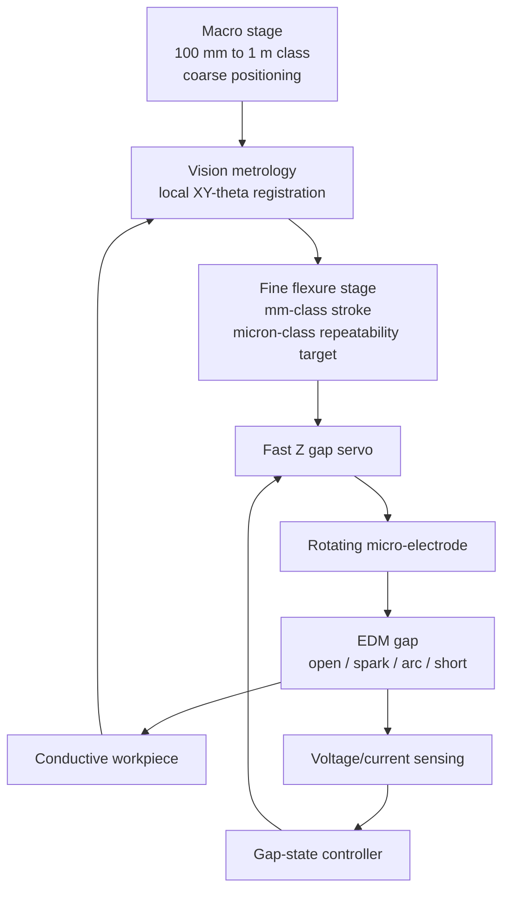

# OpenMicroEDM

**Low-cost macro/micro hybrid electrical-discharge machining using coarse motion, vision-referenced local registration, a flexure fine stage, and closed-loop gap control.**

> Status: concept / feasibility-validation stage. No machining performance is claimed yet.

OpenMicroEDM explores a specific hypothesis:

> A large, inexpensive motion platform does not need micron-class absolute accuracy if local optical metrology can recover the workpiece coordinate frame, a fine stage can remove the residual XY error, and the EDM gap-control loop provides local Z regulation at the tool tip.

The intended architecture separates **range**, **registration**, **fine positioning**, and **gap regulation**:



The project is inspired by [RepRapMicron / PIKA](https://github.com/VikOlliver/RepRapMicron), which demonstrates that ordinary FDM-printed flexures, commodity stepper hardware, and screw drives can form a repeatable micron-scale positioning platform over a small workspace. OpenMicroEDM does **not** assume that this makes a meter-scale machine micron-accurate. Instead, it treats the machine as a hierarchical positioning system:

\[
\mathbf{x}_{tool}=\mathbf{x}_{macro}+\mathbf{x}_{fine}
\]

The macro stage moves to the neighborhood; optical metrology re-establishes the local workpiece frame; the fine stage removes the local XY residual; the EDM servo maintains the inter-electrode Z condition.

## Core enabling technology: local optical registration

The long-travel machine is allowed to be inaccurate in absolute XY position as long as it lands inside the fine-stage capture range. After each coarse move, a microscope/camera observes a local fiducial or intrinsic workpiece feature, estimates the local XY/rotation error with subpixel metrology, and commands the fine stage to correct the residual.

The project therefore treats **vision metrology**, not generic AI image recognition, as a first-class subsystem. The difficult part is not simply detecting a mark; it is maintaining a calibrated transform among:

- the workpiece frame;
- the camera frame;
- the fine-stage frame;
- the electrode tool-center point.

The optical loop must be validated against lens distortion, magnification/focus change, illumination sensitivity, thermal drift, stage cross-axis error, and camera-to-tool offset. A subpixel image estimate is not automatically a micron-accurate machine coordinate.

The intended control split is:

- **XY:** optical closed loop using local registration;
- **Z:** electrical closed loop using EDM gap voltage/current.

The first serious vision milestone is not machining. It is repeated leave-and-return motion followed by local optical correction and a measured residual on the order of 1 µm. See [`docs/vision-registration.md`](docs/vision-registration.md).

## Why EDM?

A printed flexure stage is attractive for precision positioning but has limited structural stiffness. Conventional cutting loads would directly exploit that weakness. EDM is different: material removal is non-contact, so the precision stage mainly has to position the electrode and react to relatively small fluidic/electrical disturbances rather than cutting forces.

That does **not** make micro-EDM easy. The dominant engineering problems are expected to be:

1. **Vision-referenced XY registration** — local optical measurement must recover tool-to-workpiece pose after coarse moves with a quantified uncertainty budget.
2. **Gap servo stability** — the controller must distinguish open gap, useful discharges, arcing, and short circuit, then retract/advance the electrode appropriately.
3. **Electrode wear** — tool-length and tool-shape change directly corrupt dimensional accuracy.
4. **Debris evacuation** — particles in a micrometre-scale inter-electrode gap can trigger unstable secondary discharges and shorts.
5. **Thermal / creep / cross-axis error** — an FDM flexure is not a metrology frame; calibration and local reference strategies are required.
6. **Pulse-energy control** — micro-EDM requires low-energy, short-duration discharges; the power stage must be intentionally current/energy limited and electrically isolated from the motion/control electronics.

A 2026 open-access review summarizes micro-EDM as a non-contact process for electrically conductive hard-to-machine materials, with tool dimensions below 500 µm and inter-electrode gaps that can be as small as roughly 5 µm; it also identifies tool wear, debris/flushing, pulse generation, and process monitoring as core challenges: <https://link.springer.com/article/10.1007/s00170-026-18398-7>

## Development strategy

The central rule is: **do not build the large machine first.** Validate the difficult physics and metrology on a small rig, then scale the travel independently.

### Phase 0 — Positioning and metrology bench

Goal: characterize the FDM flexure and optical-registration concepts before any EDM hardware is energized.

- Print/adapt a PIKA-style flexure axis.
- Measure repeatability, hysteresis, creep, and thermal drift.
- Build the first camera/fiducial registration bench.
- Characterize static image noise and subpixel localization bias.
- Demonstrate macro leave-and-return + vision + fine-stage correction.
- Establish a calibration and uncertainty-budget method.
- Decide whether screw-driven fine Z is sufficient or whether a faster secondary actuator is required.

**Gate:** repeatable micron-scale fine motion and local optical registration must be demonstrated with independent measurements. No precision claim is accepted from pixel size, motor step count, or CAD geometry alone.

### Phase 1 — Micro-EDM drilling demonstrator

Goal: make repeatable micro-holes using the smallest defensible system.

- One coarse positioning axis or fixed coupon fixture.
- Fine Z stage.
- Gap voltage/current sensing.
- Deliberately energy-limited pulse source.
- Tungsten electrode in a small spindle.
- Dielectric bath and controlled flushing/filtration.

First target: **stable drilling with a 100–300 µm-class electrode in a conductive steel coupon**. The exact achievable hole size is an experimental result, not a promised specification.

### Phase 2 — Micro-EDM milling

Goal: add fine XY and generate 2.5D / 3D cavities by layer-wise toolpaths.

- XY flexure stage.
- Vision-referenced tool/workpiece registration.
- Tool-wear compensation.
- Electrode-length reference / touch-off routine.
- Toolpath planner and discharge-aware feed control.
- Optional electrode rotation/vibration for debris transport.

### Phase 3 — Macro/micro hybrid machine

Goal: place the validated micro-EDM head on a large, inexpensive machine.

- Coarse travel: 100 mm to 1 m class.
- Fine local travel: mm class.
- Camera/fiducial-based local coordinate registration.
- Tool-center-point calibration.
- Overlapping tiled work zones rather than demanding micron absolute accuracy across the full macro envelope.

The intended capability is:

> **Move anywhere on a large workpiece, optically establish a local coordinate frame, then perform micron-scale EDM within a small local workspace.**

It is *not*:

> “A 1 m machine with 1 µm absolute volumetric accuracy.”

## Repository layout

```text
OpenMicroEDM/
├── README.md
├── ROADMAP.md
├── CONTRIBUTING.md
├── docs/
│   ├── architecture.md
│   ├── vision-registration.md
│   ├── validation-plan.md
│   ├── safety.md
│   └── references.md
├── hardware/      # mechanical CAD / flexures / spindle / fluid loop
├── electronics/   # sensing, isolation, pulse power, interlocks
├── firmware/      # real-time gap servo and machine I/O
├── software/      # vision registration, calibration, logging, toolpaths, analysis
└── experiments/   # preregistered experiments and raw-result conventions
```

## Engineering principles

- Separate **coarse travel**, **optical registration**, **fine positioning**, and **gap regulation**. They solve different problems.
- Treat commanded microsteps as commands, not proof of physical accuracy.
- Treat subpixel localization as a measurement estimate, not proof of tool-tip accuracy.
- Prefer relative tool-to-local-reference measurement over reliance on global machine coordinates.
- Independently measure repeatability and drift.
- Maintain an explicit camera/fine-stage/tool-center-point calibration chain.
- Log voltage/current waveforms and actuator commands for every serious EDM experiment.
- Design for short-circuit recovery before optimizing material-removal rate.
- Treat electrode wear as a state variable, not an afterthought.
- Do not infer global machine accuracy from local flexure repeatability.
- Prefer experiments that can falsify the architecture early.

## Immediate questions

1. Can low-cost microscopic vision repeatedly recover a local XY-theta frame with a tool-relevant residual on the order of 1 µm after randomized coarse-stage repositioning?
2. What optical configuration, fiducial geometry, and subpixel estimator minimize bias under focus, illumination, temperature, and contamination changes?
3. Can the electrode tip and local fiducial be observed in the same optical frame, or how often must camera-to-tool offset be recalibrated?
4. Can an FDM flexure fine-Z axis maintain useful repeatability under spindle/fluid disturbances?
5. What actuator bandwidth is required for stable gap regulation on the intended pulse regime?
6. Can open/spark/arc/short states be classified robustly from low-cost voltage/current sensing?
7. How much does electrode rotation improve debris evacuation on the first drilling rig?
8. Can tool wear be measured or inferred cheaply enough for layer-wise micro-EDM milling?
9. At what point does a metal or piezo fine stage become necessary?

## Safety

EDM combines electrical energy, conductive debris, moving machinery, and potentially flammable or contaminated dielectric fluid. The prototype must use isolation, current/energy limiting, guarding, interlocks, emergency shutoff, and a deliberate fluid-management strategy. See [`docs/safety.md`](docs/safety.md).

Do not use a mains-referenced improvised discharge circuit.

## Upstream / prior art

- RepRapMicron / PIKA: <https://github.com/VikOlliver/RepRapMicron>
- RepRapMicron project page: <https://reprap.org/wiki/RepRapMicron>
- 2026 microscopic subpixel alignment measurement: <https://www.mdpi.com/1424-8220/26/13/4040>
- 2026 telecentric calibration + subpixel edge detection: <https://www.sciencedirect.com/science/article/pii/S0263224126009486>
- 2026 microscopic workpiece repositioning / coarse-to-fine registration: <https://www.sciencedirect.com/science/article/pii/S2095809926004510>
- 2026 micro-EDM review: <https://link.springer.com/article/10.1007/s00170-026-18398-7>
- 2026 dielectric/debris CFD study: <https://www.mdpi.com/2072-666X/17/6/747>
- Electrode manufacturing / dielectric review: <https://www.mdpi.com/2075-1702/11/9/906>

More references and the rationale for each are in [`docs/references.md`](docs/references.md).

## License

GPL-3.0-or-later. This choice keeps future code/CAD reuse compatible with GPL-licensed RepRapMicron-derived work if such reuse is introduced. Third-party source files must retain their original license notices and attribution.
