# System Architecture

## Intent

The architecture avoids a common precision-machine trap: forcing one mechanical subsystem to provide both long travel and micron-level local precision.

The system is decomposed into four nested control problems:

1. **Macro positioning** — move the head near the requested feature.
2. **Vision-referenced registration** — recover the local workpiece coordinate frame and estimate residual XY/rotation error.
3. **Fine positioning** — place the electrode within a local mm-scale workspace.
4. **Gap regulation** — continuously maintain a discharge-capable inter-electrode condition.

The core hypothesis is therefore not simply that a flexure stage is precise. It is that a coarse machine can be made locally precise by **measurement and correction**.

## Coordinate model

For one translational axis:

\[
x_{tool} = x_{macro} + x_{fine} + e_{registration} + e_{local}
\]

where `e_registration` is the residual after local optical alignment, and `e_local` contains calibration residuals, thermal drift, compliance, and measurement error.

The macro stage only needs to land inside the fine stage's capture range. A local fiducial or intrinsic workpiece feature is then used to establish the workpiece frame.

For the optical chain, use explicit transforms among workpiece (`W`), camera (`C`), fine stage (`F`), and tool center point (`T`):

\[
{}^{W}T_{T} = {}^{W}T_{C}\;{}^{C}T_{F}\;{}^{F}T_{T}
\]

This makes camera distortion, fine-stage calibration, and camera-to-tool offset separate measurable error sources rather than hiding them inside a single image-registration result.

## Functional block diagram

```mermaid
flowchart LR
    P[Toolpath planner] --> M[Macro motion controller]
    M --> MS[Macro XYZ]
    MS --> CAM[Microscope / camera]
    CAM --> CAL[Optical calibration / distortion correction]
    CAL --> DET[Fiducial or intrinsic-feature detector]
    DET --> REG[Subpixel local XY-theta registration]
    REG --> F[Fine position controller]
    F --> FS[Fine XY / Z flexure]
    FS --> SP[Electrode spindle / tool center point]
    SP --> GAP[Inter-electrode gap]
    PSU[Energy-limited pulse source] --> GAP
    GAP --> VI[Isolated V/I sensing]
    VI --> C[Gap-state estimator]
    C --> GS[Fast Z / retract controller]
    GS --> FS
    FS --> CAM
```

The intended control split is:

- **XY:** optical closed loop;
- **Z:** electrical EDM-gap closed loop.

See [`vision-registration.md`](vision-registration.md) for the optical metrology architecture and research plan.

## Vision-referenced local registration

The camera subsystem is not a generic machine-vision accessory. It is a metrology subsystem whose output directly defines the local machining frame.

The preferred implementation minimizes reliance on a mechanically fixed camera-to-tool offset. If practical, the electrode tip and local fiducial should be observable in the same optical frame. Otherwise, the camera-to-tool transform must be explicitly calibrated and periodically verified.

The vision pipeline should contain at least:

1. image acquisition after macro-stage settling;
2. distortion / scale correction;
3. coarse fiducial or feature detection;
4. subpixel XY-theta refinement;
5. conversion into workpiece/fine-stage coordinates;
6. fine-stage correction;
7. verification image and residual calculation.

Pixel size is not a positioning specification. The machine-level accuracy claim must be based on the final tool-to-local-reference residual and an uncertainty budget that includes optical, calibration, mechanical, thermal, and temporal effects.

## Fine-stage options

### A. Screw-driven printed flexure

Pros:
- low cost;
- large mm-class travel relative to piezo;
- easy to fabricate and modify;
- compatible with RepRapMicron-like construction.

Risks:
- limited dynamic bandwidth;
- PLA creep and temperature sensitivity;
- screw pitch error and runout;
- stepper torque ripple;
- spindle/fluid disturbance coupling.

### B. Printed flexure + fast secondary actuator

A slow screw axis provides range while a smaller piezo/voice-coil/flexure element provides fast gap correction.

Pros:
- separates range and bandwidth;
- potentially better short-circuit recovery.

Risks:
- more sensing/control complexity;
- actuator stroke may be small;
- piezo hysteresis/creep requires control awareness.

The project should not select B merely because it sounds more precise. Measurement should determine whether A is inadequate.

## Gap-control abstraction

The controller does not need a globally calibrated nanometre Z coordinate to be useful. EDM itself provides electrical information about gap condition.

Initial state set:

- `OPEN`: no useful discharge activity; advance conservatively.
- `DISCHARGE`: desired intermittent spark activity; hold/slow feed.
- `ARC`: sustained conductive event; retract.
- `SHORT`: near-zero gap voltage / excessive current condition; rapid retract and recover.

Exact thresholds and timing must be derived from measured waveforms. They are process-dependent and should not be hard-coded from literature alone.

## Tool-side vs workpiece-side fine motion

RepRapMicron/PIKA primarily moves a small work stage. For a large-workpiece EDM machine, tool-side fine motion is preferable because the workpiece cannot be carried on the fine stage.

Therefore the first mechanical adaptation should preserve the **flexure principle**, not blindly preserve the exact PIKA geometry.

## Macro-stage scaling

Macro-stage errors can be tolerated if:

1. the macro stage lands within fine-stage travel;
2. local optical registration is available;
3. the fine stage has enough stroke to compensate the residual;
4. the camera/tool transform remains calibrated;
5. tile-to-tile stitching error is quantified when continuous patterns cross local workspaces.

This is why the long-term claim is **large accessible workspace with locally referenced micro-machining**, not metre-scale micron absolute accuracy.
