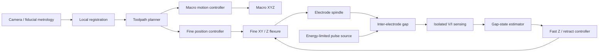

# System Architecture

## Intent

The architecture avoids a common precision-machine trap: forcing one mechanical subsystem to provide both long travel and micron-level local precision.

The system is decomposed into three nested control problems:

1. **Macro positioning** — move the head near the requested feature.
2. **Fine positioning** — place the electrode within a local mm-scale workspace.
3. **Gap regulation** — continuously maintain a discharge-capable inter-electrode condition.

## Coordinate model

For one axis:

\[
x_{tool} = x_{macro} + x_{fine} + e_{local}
\]

where `e_local` contains calibration residuals, thermal drift, compliance, and measurement error.

The macro stage only needs to land inside the fine stage's capture range. Local fiducials or a reference feature can then establish the local frame.

## Functional block diagram

## Fine-stage options

### A. Screw-driven printed flexure

Pros:
- low cost;
- large mm-class travel relative to piezo;
- easy to fabricate and modify;
- compatible with RepRapMicron-like construction.

Risks:
- limited dynamic bandwidth;
- PLA creep and temperature sensitivity;
- screw pitch error and runout;
- stepper torque ripple;
- spindle/fluid disturbance coupling.

### B. Printed flexure + fast secondary actuator

A slow screw axis provides range while a smaller piezo/voice-coil/flexure element provides fast gap correction.

Pros:
- separates range and bandwidth;
- potentially better short-circuit recovery.

Risks:
- more sensing/control complexity;
- actuator stroke may be small;
- piezo hysteresis/creep requires control awareness.

The project should not select B merely because it sounds more precise. Phase M1/M3 measurements should determine whether A is inadequate.

## Gap-control abstraction

The controller does not need a globally calibrated nanometre Z coordinate to be useful. EDM itself provides electrical information about gap condition.

Initial state set:

- `OPEN`: no useful discharge activity; advance conservatively.
- `DISCHARGE`: desired intermittent spark activity; hold/slow feed.
- `ARC`: sustained conductive event; retract.
- `SHORT`: near-zero gap voltage / excessive current condition; rapid retract and recover.

Exact thresholds and timing must be derived from measured waveforms. They are process-dependent and should not be hard-coded from literature alone.

## Tool-side vs workpiece-side fine motion

RepRapMicron/PIKA primarily moves a small work stage. For a large-workpiece EDM machine, tool-side fine motion is preferable because the workpiece cannot be carried on the fine stage.

Therefore the first mechanical adaptation should preserve the **flexure principle**, not blindly preserve the exact PIKA geometry.

## Macro-stage scaling

Macro-stage errors that are slowly varying or repeatable can be tolerated if:

1. the macro stage lands within fine-stage travel;
2. local registration is available;
3. the fine stage has enough stroke to compensate residual error;
4. tile-to-tile stitching is calibrated when continuous patterns cross local workspaces.

This is why the long-term claim is **large accessible workspace with local micro-machining**, not metre-scale micron absolute accuracy.
