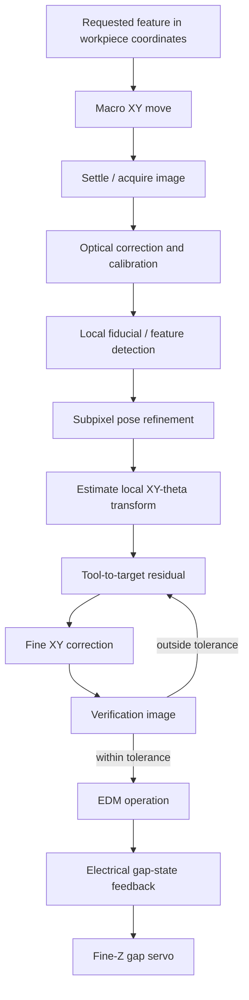

# Vision-Referenced Local Registration

## Why this is a core technology

The macro/micro EDM concept only becomes compelling if the large coarse machine does **not** need micron-class absolute accuracy. The enabling mechanism is therefore not merely image recognition; it is **vision metrology and local coordinate registration**.

The intended division of responsibility is:

- **XY:** optical closed loop based on local fiducials or intrinsic workpiece features;
- **Z:** electrical closed loop based on EDM gap voltage/current;
- **Macro motion:** only needs to place the camera/tool inside the local fine-stage capture range.

The architecture should be judged by this question:

> After an arbitrary coarse-stage move, can the system re-establish the local workpiece coordinate frame and place the tool relative to that frame with a measured residual error on the order of 1 µm?

This is a target to validate, not a current performance claim.

## Control concept

The important distinction is that the machine does not need to know its globally correct Cartesian position to micron accuracy. It needs to know the **relative pose of the tool and the local reference** accurately enough for the fine stage to remove the residual.

## Coordinate model

Use explicit coordinate frames:

- `W`: local workpiece frame;
- `C`: camera frame;
- `F`: fine-stage frame;
- `T`: tool-center-point frame.

A useful conceptual chain is

\[
{}^{W}T_{T} = {}^{W}T_{C}\;{}^{C}T_{F}\;{}^{F}T_{T}
\]

where each transform has a different calibration or measurement source.

The long-term system should continuously distinguish:

1. **macro-stage landing error**;
2. **camera-to-workpiece registration error**;
3. **camera/fine-stage calibration error**;
4. **tool-center-point offset error**;
5. **fine-stage actuation error**;
6. **thermal/focus/illumination drift**.

A single image-matching score is not an uncertainty model.

## Optical architecture

### Preferred direction: tool-referenced imaging

If practical, image the electrode tip and the local fiducial in the same optical frame. This minimizes dependence on a fixed mechanical camera-to-tool offset.

Candidate architectures:

1. **On-axis / near-coaxial imaging** using a beam splitter or microscope arrangement.
2. **Off-axis camera with direct tool-tip observation**, followed by explicit camera-to-tool calibration.
3. **Fixed camera + calibrated transfer move** only as a fallback, because Abbe/offset errors and thermal drift become more important.

Telecentric optics should be investigated for planar XY metrology because magnification changes with object distance and perspective error can otherwise contaminate dimensional estimates. Whether a telecentric lens is worth the cost must be decided experimentally.

## Fiducial and feature strategy

Two classes should be compared:

### Artificial fiducials

Possible candidates:

- cross / box-cross targets;
- circles / concentric rings;
- dot arrays;
- periodic phase/grating patterns;
- lithographically or EDM-machined local marks.

Evaluation criteria:

- localization repeatability;
- rotational observability;
- tolerance to contamination / dielectric droplets / surface finish;
- sensitivity to focus and illumination;
- manufacturability on the intended workpiece.

### Intrinsic workpiece features

Using existing microstructure avoids adding marks and may enable re-clamping or continuation machining. It also creates a harder registration problem because surface texture can change during machining.

A 2026 ultra-precision machining study reports a coarse-to-fine registration approach using inherent microscale surface features, with geometric coarse alignment followed by subpixel template matching: <https://www.sciencedirect.com/science/article/pii/S2095809926004510>

This should be treated as prior art to investigate, not as a directly transferable performance claim.

## Candidate localization methods

Start with deterministic metrology methods before machine learning.

1. **Model-based edge fitting**
   - estimate edge center from the grayscale edge-response rather than integer pixels;
   - suitable for crosses, circles, and line fiducials.

2. **Subpixel template registration**
   - coarse search followed by local continuous optimization;
   - suitable when the local texture is stable.

3. **Phase correlation / frequency-domain registration**
   - attractive for pure or small translation;
   - must be evaluated under rotation, illumination change, and local surface modification.

4. **Geometric primitive fitting**
   - circle/ellipse/line fitting after subpixel edge extraction;
   - yields interpretable residuals and uncertainty diagnostics.

Deep-learning feature detection is not the default because deterministic fiducials and calibrated optics may provide lower uncertainty, easier validation, and better failure observability.

Recent work on microscopic alignment explicitly treats repeatability as a subpixel edge-center estimation problem: <https://www.mdpi.com/1424-8220/26/13/4040>

A 2026 telecentric metrology paper also couples calibration, distortion correction, lighting compensation, and subpixel edge detection rather than treating localization as an isolated algorithmic problem: <https://www.sciencedirect.com/science/article/pii/S0263224126009486>

## Calibration stack

The vision system should not be accepted until at least the following are characterized:

### C0 — Pixel scale and distortion

- physical µm/pixel calibration;
- lens distortion map;
- repeatability across the intended field of view;
- focus dependence of the calibrated scale.

### C1 — Fine-stage-to-camera transform

Move the fine XY stage through a calibrated grid and fit the mapping between actuator commands / measured stage motion and image displacement.

Measure:

- scale;
- orthogonality;
- cross-axis coupling;
- local nonlinearity;
- hysteresis.

### C2 — Tool-center-point calibration

Estimate the electrode tip location in the same coordinate system used for fiducial localization.

Preferred: direct simultaneous observation.

Fallback: calibrated tool/camera offset with periodic verification.

### C3 — Thermal and temporal drift

Measure registration bias over at least 10 min and 60 min while recording temperature.

### C4 — Illumination and focus sensitivity

Repeat the same localization under controlled variations in:

- illumination intensity;
- illumination direction if applicable;
- exposure;
- focus / workpiece Z offset;
- dielectric film / contamination representative of EDM use.

## Validation metrics

Do not report only pixel-domain repeatability.

Required metrics:

- residual translation error in µm;
- residual rotation error;
- RMS and 95th-percentile registration error;
- repeatability after macro-stage leave-and-return cycles;
- error versus field position;
- error versus temperature/time;
- error versus focus / illumination;
- fine-stage correction magnitude required;
- final verified tool-to-fiducial residual.

Initial research target:

> Demonstrate repeated local XY registration with <= 1 µm residual after randomized macro-stage repositioning, measured by an independent or self-consistent metrology procedure with a documented uncertainty budget.

This target can be relaxed or tightened after the optical system is characterized.

## Proposed experiments

### V000 — Static image repeatability

Acquire 100+ images without moving the machine.

Measure apparent fiducial position variation. This establishes the algorithm + camera + illumination noise floor.

### V001 — Fine-stage known-motion test

Apply small calibrated fine-stage motions and compare commanded/measured displacement with image-estimated displacement.

Purpose: detect scale error, nonlinearity, cross-axis coupling, and subpixel estimator bias.

### V002 — Macro leave-and-return registration

1. Observe a fiducial.
2. Move the macro stage away by a large distance.
3. Return using only the coarse stage.
4. Re-estimate local pose optically.
5. Correct with fine XY.
6. Acquire a verification image.
7. Repeat at least 100 cycles with randomized approach directions.

Primary metric: final residual distribution after optical + fine-stage correction.

### V003 — Tool-to-fiducial registration

Repeat V002 while estimating the actual tool-center point rather than only the camera image center.

This experiment is the real gate for machining relevance.

### V004 — Tile-to-tile stitching

Use overlapping local workspaces. Reconstruct adjacent local frames from shared fiducials or intrinsic features and measure accumulated error over multiple tiles.

## Research questions

1. What optical magnification / FOV gives the best trade between capture range and localization uncertainty?
2. Is a telecentric lens required, or can calibrated conventional microscope optics meet the local target?
3. Which fiducial geometry gives the best XY-theta observability under EDM contamination?
4. Can the electrode tip and fiducial be observed simultaneously?
5. Which subpixel estimator has the lowest bias under focus and illumination changes?
6. How often must tool-center-point calibration be repeated?
7. Is tile-to-tile error bounded, or does it accumulate into an unusable global drift?
8. Can intrinsic workpiece features replace dedicated fiducials for some operations?
9. What is the complete uncertainty budget at the tool tip?

## References to investigate

- Sun & Wang, 2026, microscopic subpixel alignment measurement: <https://www.mdpi.com/1424-8220/26/13/4040>
- Lai et al., 2026, telecentric calibration and subpixel edge detection: <https://www.sciencedirect.com/science/article/pii/S0263224126009486>
- 2026 ultra-precision workpiece positioning using microscopic coarse-to-fine registration: <https://www.sciencedirect.com/science/article/pii/S2095809926004510>
- 2025 optical metrology review: <https://pmc.ncbi.nlm.nih.gov/articles/PMC12656061/>
- Hand-eye calibration background and current methods: <https://link.springer.com/article/10.1007/s00138-024-01572-w>
